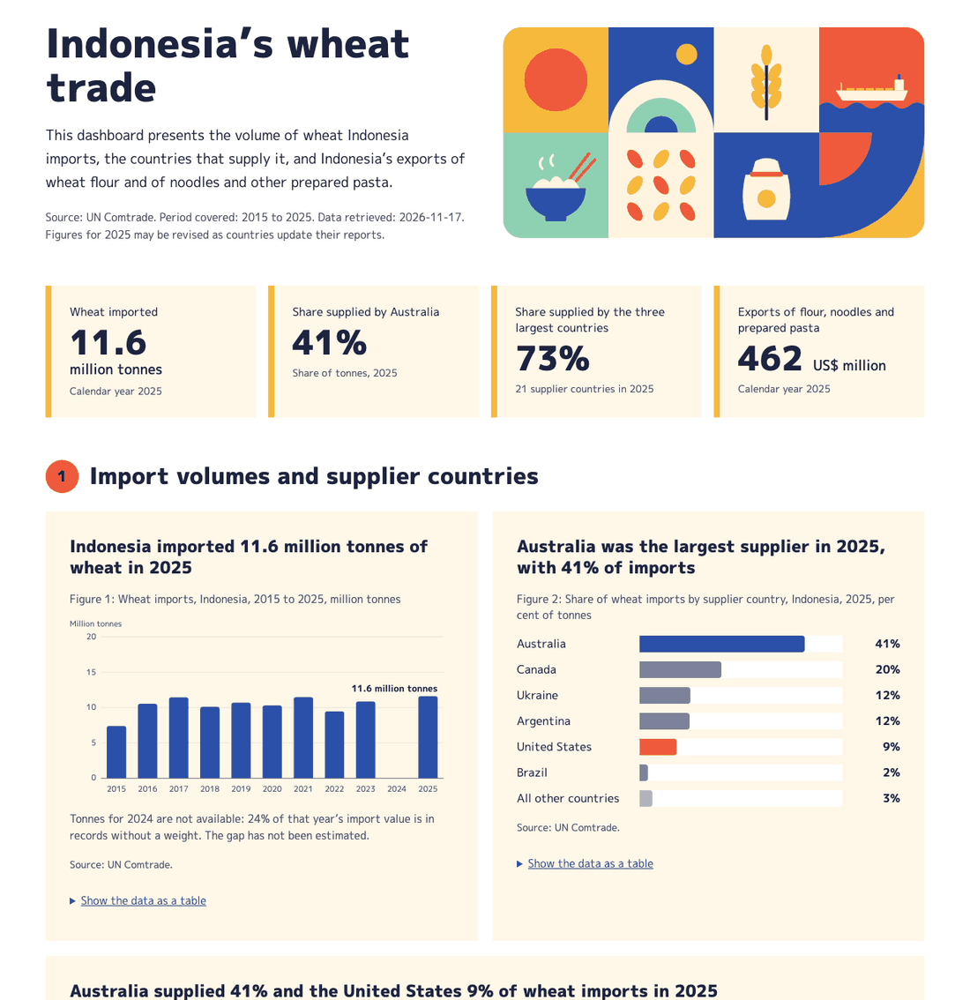
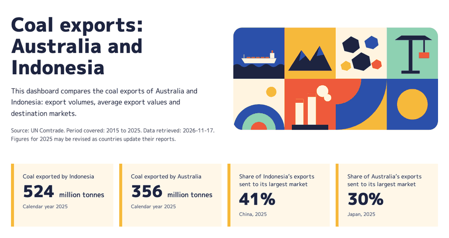

# Asia commodity trade

Two dashboards on commodity trade involving Australia and Indonesia, built from official
trade statistics published by UN Comtrade.

| Dashboard | Question |
|---|---|
| Indonesia's wheat trade | How much wheat does Indonesia import, from which countries, and how much flour and noodles does it export? |
| Coal exports: Australia and Indonesia | How do the two countries compare on export volume, average export value and destination markets? |

**Live site: [cesinata.github.io/asia-commodity-trade](https://cesinata.github.io/asia-commodity-trade/)**

<table>
<tr>
<td width="50%"><a href="https://cesinata.github.io/asia-commodity-trade/wheat/"></a></td>
<td width="50%"><a href="https://cesinata.github.io/asia-commodity-trade/coal/"></a></td>
</tr>
<tr>
<td align="center"><a href="https://cesinata.github.io/asia-commodity-trade/wheat/">Indonesia's wheat trade</a></td>
<td align="center"><a href="https://cesinata.github.io/asia-commodity-trade/coal/">Coal exports: Australia and Indonesia</a></td>
</tr>
</table>

## Findings
Figures are rounded from the tables in `data/marts/`. Volumes are in tonnes; values are in
US dollars at current prices.

1. **Coal export volumes.** Indonesia exported 367.0 million tonnes of coal and lignite in 2015
   and 524.0 million tonnes in 2025. Australia exported 387.8 million tonnes in 2015 and 355.6
   million tonnes in 2025. *Source: `data/marts/mart_coal_exports_year.csv`.*
2. **Wheat suppliers.** Australia supplied 40.6% of Indonesia's wheat imports by tonnes in 2025
   (4.72 million tonnes), compared with 57.6% in 2015. The three largest suppliers together held
   73.3% in 2025 and 89.7% in 2015. *Source: `data/marts/mart_wheat_suppliers.csv` and
   `data/marts/mart_wheat_concentration.csv`.*
3. **Noodle and prepared pasta exports.** Indonesia's exports of noodles and other prepared pasta
   (HS 190230) were worth US$178.3 million in 2015 and US$437.2 million in 2025. Volume rose from
   110.4 to 216.4 thousand tonnes. *Source: `data/marts/mart_wheat_product_exports.csv`.*

## In progress: Tableau Public dashboards
Each dashboard is being rebuilt as a Tableau Public workbook from the same tables in
`data/marts/`, with filters by year and partner country. Links will be added here when they
are published. The build plan is in [tableau/README.md](tableau/README.md).

| Workbook | Sheets | Status |
|---|---|---|
| Indonesia's wheat trade | Key figures, import volume, supplier shares, Australia and United States shares, flour and noodle exports, comparison of reported trade | In progress |
| Coal exports: Australia and Indonesia | Key figures, export volume, average export value, destinations, share sent to China, comparison of reported trade | In progress |

## How it works
```text
UN Comtrade API -> src/fetch.py -> data/raw/ (stays on your computer)
                -> sql/01_staging.sql, 02_marts.sql, 03_checks.sql (DuckDB, run by src/build.py)
                -> data/marts/*.csv (for Tableau) and docs/data/*.json (for the web pages)
                -> docs/ (GitHub Pages)
```

## Run it
```bash
python3 -m venv .venv
source .venv/bin/activate
pip install -r requirements.txt

cp .env.example .env          # then paste your free UN Comtrade key into .env
python tests/smoke_test.py    # checks the SQL logic on simulated data
python src/fetch.py --preview # one test call, no key needed
python src/fetch.py --story all
python src/build.py
python3 -m http.server -d docs 8000   # open http://localhost:8000
```
A free key comes from comtradedeveloper.un.org (product "comtrade - v1").

## Method
- **Source and period:** UN Comtrade, annual data, calendar years from 2015.
- **Products:** wheat (HS 1001), wheat flour (HS 1101), noodles and other prepared pasta
  (HS 190230), coal and lignite (HS 2701 and 2702).
- **Measures:** volume in tonnes; value in US dollars at current prices.
- **Shares:** a partner's tonnes divided by the total of all partner rows in that year.
- **Data checks:** duplicate records, negative values, missing years, missing weights, world
  totals without a weight, and partner rows compared with the reported world total. A failed
  check stops the build.
- **Comparison of reported trade:** what one country records is compared with what its partner
  records, in tonnes. Differences above 10% are marked for review.

## Limitations
- The most recent year can be incomplete or revised, because countries report late.
- Where more than 1% of a year's value is in records without a weight, tonnes and shares for
  that year are shown as not available, not estimated. This applies to Indonesia's 2024 wheat
  imports: 24% of that year's import value has no weight.
- A year recorded by only one side of a trade comparison is shown as "not recorded" and marked
  for review (Australia's coal exports to China in 2022).
- HS 190230 covers instant noodles together with other prepared pasta.
- The coal data does not separate coal for power generation from coal for steelmaking.
- Values are not adjusted for inflation.
- The dashboards describe what changed. They do not explain why.

## Data and licence
Source: UN Comtrade, United Nations Statistics Division. Raw downloads are not included in this repository. It contains aggregated tables and charts only.

## Origin
This project extends an analysis I made for the Satria Data 2021 statistics competition.
